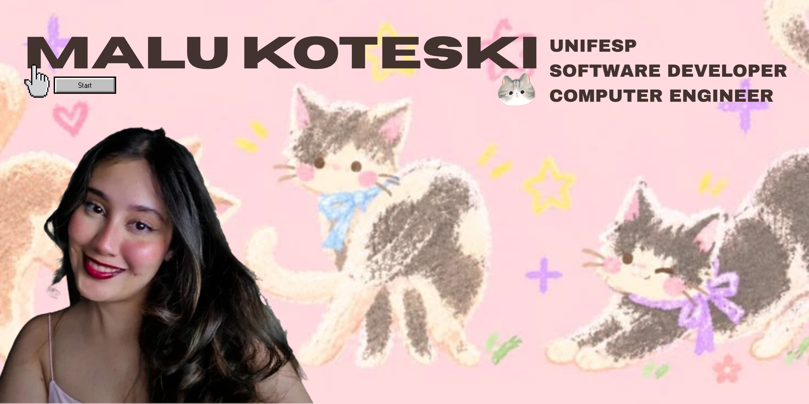

<picture>
  <source media="(prefers-color-scheme: dark)" srcset="https://readme-typing-svg.demolab.com?font=JetBrains+Mono&weight=600&size=19&duration=2800&pause=900&color=F778BA&background=00000000&vCenter=true&width=620&height=44&lines=%3E+fullstack+dev+intern+%40+IACIT;%3E+undergrad+%40+UNIFESP;%3E+typescript+%C2%B7+javascript+%C2%B7+java;%3E+python+%C2%B7+c%2B%2B+%C2%B7+html+%C2%B7+css">
  
</picture>

## Now

- **Working @ IACIT** — Developing full-stack web applications with TypeScript, JavaScript, and Java.
- **Studying @ UNIFESP** — Undergraduate coursework in Computer Engineering, Programming Logic, Python, C++, and Electric Circuits.
- **Ask me about** — Full-stack development, Python algorithms, or TypeScript projects.

## Work & Projects

| Project                   | Description                                                                                                                                                                                                           | Link                                                                                                                                                                           |
| :------------------------ | :-------------------------------------------------------------------------------------------------------------------------------------------------------------------------------------------------------------------- | :----------------------------------------------------------------------------------------------------------------------------------------------------------------------------- |
| **SAIF**                  | Featured software project developed and maintained on GitHub, focused on clean architecture and problem solving.                                                                                                      |                               |
| **Programacao-Python**    | Structured resolutions and algorithms for the Programming Logic course at UNIFESP.         |  |
| **circuitos-eletricos-I** | Electric Circuits I simulation and coursework tools built with TypeScript.     |                    |
| **lp-aulas**              | Class notes, exercises, and practical examples from Programming Logic lectures.            |                                 |

## Stack

<b>&nbsp;Experience & Education</b> &nbsp;—&nbsp; IACIT & UNIFESP

 

| When                                                                                            | Where                                                                        | What                                                                                       |
| :---------------------------------------------------------------------------------------------- | :--------------------------------------------------------------------------- | :----------------------------------------------------------------------------------------- |
|        | **Fullstack Dev Intern**   IACIT                                          | Full-stack software development using JavaScript, TypeScript, Java, Python, HTML, and CSS. |
|  | **Universidade Federal de São Paulo (UNIFESP)**   São José dos Campos, SP | Coursework in Computer Engineering, Programming Logic, Python, C++, and Electric Circuits. |

## Telemetry

<table width="100%">
<tr>
<td width="50%" align="center"></td>
<td width="50%" align="center"></td>
</tr>
</table>

## Talk to me

> Want to collaborate on a project or talk about tech? Feel free to reach out via email or connect on GitHub.  
> **São José dos Campos, Brasil**

